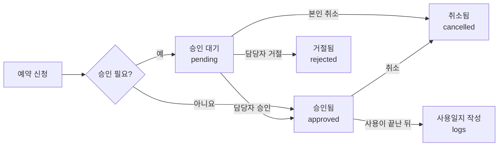

# equip-hub 스펙

Nov 6, 2026 · @하은지

## 개요

equip-hub는 여러 연구실이 같이 쓰는 공동기기를 예약하고 기기별 매뉴얼을 보는 웹 앱이다. 주소는 `https://kkonoo.github.io/equip-hub/`(GitHub Pages)다.

| 항목 | 결정 |
| --- | --- |
| 사용자 | 구글 로그인 후 가입 신청, 총관리자가 승인 |
| 예약 확정 | 기기마다 승인 여부를 설정, 기본값은 승인 필요 |
| 매뉴얼 | 앱 안에 텍스트로 쓰고, PDF·사진은 구글 드라이브 링크로 붙임 |
| 관리 | 관리자 페이지(admin.html)를 따로 둠 |
| 첫 버전 기능 | 예약, 매뉴얼, 사용일지, 예약 규칙, 점검·고장 표시, 연구실별 사용 통계 |
| 저장소 | 새 Firebase 프로젝트 (Google 로그인 + Firestore) |

## 사용자와 권한

역할은 네 가지다. 기기 담당자는 역할 값이 아니라 기기마다 지정한다. 그래서 한 사람이 어떤 기기에선 담당자, 다른 기기에선 일반 사용자가 될 수 있다.

| 역할 | 누구 | 할 수 있는 것 |
| --- | --- | --- |
| 가입 대기 | 가입 신청만 한 사람 | '승인 대기 중' 화면만 봄 |
| 사용자 | 승인된 연구실 구성원 | 예약 현황·매뉴얼 보기, 예약 신청, 본인 예약 취소, 사용일지 작성 |
| 기기 담당자 | 기기마다 지정된 사용자 (여러 명 가능) | 담당 기기의 예약 승인·거절·취소, 매뉴얼·규칙·상태 수정, 사용일지·통계 보기 |
| 총관리자 | 앱 운영자 (처음엔 본인) | 위의 모든 것 + 가입 승인, 기기·연구실 추가, 담당자 지정, 전체 통계, 백업 |

가입 흐름:

1. 구글 계정으로 로그인한다.
2. 처음이면 가입 신청 폼에 이름과 소속 연구실을 적는다. 연구실은 목록에서 고르고, 없으면 직접 입력한다.
3. 신청은 관리자 페이지의 가입 승인 탭에 쌓이고, 총관리자가 승인하거나 거절한다.
4. 승인되면 다음 접속부터 사용자 화면이 열린다.

첫 총관리자는 Firebase 콘솔에서 본인 `users` 문서의 `role`을 `admin`으로 직접 바꿔서 만든다.

## 예약 흐름

승인은 기기마다 켜고 끌 수 있고, 새로 추가한 기기는 '승인 필요'가 기본값이다.

예약 상태 흐름 (상태 4개, 분기 1개):



승인 대기와 승인됨은 둘 다 그 시간을 차지하고, 거절되거나 취소되면 시간이 풀린다. 본인은 시작 전까지 취소할 수 있고, 담당자와 총관리자는 언제든 사유를 적고 취소할 수 있다.

예약 규칙 (기기별):

| 규칙 | 기본값 | 동작 |
| --- | --- | --- |
| 예약 단위 | 30분 | 그리드 칸 크기 |
| 1회 최대 시간 | 제한 없음 | 넘으면 신청할 수 없음 |
| 며칠 앞까지 | 제한 없음 | 오늘부터 N일 뒤까지만 예약 |
| 예약 가능 시간대 | 제한 없음 (하루 종일) | 이 밖의 칸은 막음 |

겹침 처리:

- 저장하기 전에 같은 기기의 승인 대기·승인된 예약과 겹치는지 앱에서 확인하고, 겹치면 막는다.
- 두 사람이 거의 동시에 같은 칸을 신청하면 둘 다 들어갈 수 있다. 승인이 필요한 기기는 담당자 화면에 겹침 경고가 뜨므로 거기서 정리한다.
- 승인이 필요 없는 기기에서는 이 경우가 그대로 남는다. 첫 버전의 알려진 한계로 둔다.

점검·고장:

- 기기 상태가 점검이나 고장이면 새 예약을 받지 않는다.
- 그 기간에 이미 잡힌 예약은 자동으로 취소하지 않고, 담당자 화면에 경고로 보여 준다.

## 사용자 화면 (index.html)

사용자 화면은 예약, 내 예약, 기기 세 탭이다. 로그인한 사람이 담당자나 총관리자면 상단에 관리자 페이지 링크가 보인다.

| 탭 | 하는 일 |
| --- | --- |
| 예약 | 기기를 고르면 주간 그리드(가로 요일, 세로 시간)가 나온다. 900px 이하에서는 하루 보기. 빈 칸을 누르면 예약 창이 열리고, 다른 사람 예약을 누르면 이름·연구실·시간이 보인다. |
| 내 예약 | 다가오는 예약과 지난 예약. 상태 칩(승인 대기, 승인, 거절+사유, 취소), 시작 전엔 취소 버튼, 끝난 예약엔 사용일지 쓰기 버튼과 미작성 표시. |
| 기기 | 기기 카드 목록(이름, 위치, 상태 칩, 담당자, 승인 필요 여부). 누르면 매뉴얼 본문, 링크 목록, 예약 규칙이 나오고 바로 예약하기로 넘어간다. |

- 그리드 칸 표시: 승인된 예약, 승인 대기(연하게), 내 예약(accent), 점검·고장 기간(회색, 예약 불가)을 구분한다.
- 예약 창: 시작·종료(누른 칸으로 미리 채움), 사용 목적 한 줄. 승인이 필요한 기기면 버튼이 '신청', 아니면 '예약'이다.
- 사용일지 창: 실제 시작·종료(예약 시간으로 미리 채움), 특이사항, '문제 있었음' 체크.
- 매뉴얼 본문은 줄바꿈을 그대로 보여 주는 텍스트다. 링크는 제목+URL 목록으로 따로 둔다.

## 관리자 페이지 (admin.html)

관리자 페이지는 담당자와 총관리자만 열 수 있다. 담당자는 자기 담당 기기만 본다. 승인 대기 건수는 탭에 배지로 보여 준다.

| 탭 | 하는 일 | 보는 사람 |
| --- | --- | --- |
| 예약 승인 | 승인 대기 목록, 승인·거절(사유), 같은 시간에 겹치는 신청 경고 | 담당자, 총관리자 |
| 가입 승인 | 가입 신청 승인·거절, 사용자 목록, 역할 변경, 비활성화 | 총관리자 |
| 기기 | 기기 추가·수정·순서, 담당자 지정, 승인 필요 여부, 예약 규칙, 상태(정상/점검/고장 + 사유·기간), 매뉴얼·링크 | 총관리자 전체, 담당자는 담당 기기(담당자 지정 제외) |
| 사용일지 | 기기별 일지 목록, '문제 있었음'은 위로 | 담당자, 총관리자 |
| 통계 | 월을 고르면 연구실 × 기기 사용 시간 표 | 총관리자, 담당자는 담당 기기만 |
| 연구실 | 연구실 추가·이름 수정, 가입 때 직접 입력된 연구실 정리 | 총관리자 |
| 데이터 | 전체 백업 파일 저장(JSON) | 총관리자 |

통계의 사용 시간은 사용일지가 있으면 실제 시간, 없으면 승인된 예약 시간으로 셈다. 표에는 두 값을 나눠 보여 준다(일지 기준 / 예약 기준).

## 데이터 구조 (Firestore)

여러 사람이 같은 데이터를 봐야 하므로 `users/{uid}/…` 아래가 아니라 최상위 공유 컨렉션 다섯 개를 쓴다.

| 컨렉션 | 문서 하나 | 주요 필드 |
| --- | --- | --- |
| `users/{uid}` | 사용자 | name, email, labId, labName, role(`pending` / `member` / `admin`), active, createdAt, approvedBy, approvedAt |
| `labs/{labId}` | 연구실 | name, order |
| `equipment/{equipId}` | 기기 | name, location, managers\[uid\], requiresApproval, rules{slotMinutes, maxHours, maxDaysAhead, openFrom, openTo}, status(`ok` / `maintenance` / `broken`), statusNote, statusUntil, manual{body, links\[{title, url}\]}, order, updatedAt |
| `bookings/{bookingId}` | 예약 | equipId, uid, userName, labId, start, end, purpose, status(`pending` / `approved` / `rejected` / `cancelled`), decidedBy, decidedAt, reason, createdAt, updatedAt |
| `logs/{bookingId}` | 사용일지 | equipId, uid, labId, actualStart, actualEnd, note, problem, createdAt, updatedAt |

- 시간은 Firestore Timestamp로 저장하고 화면은 Asia/Seoul로 보여 준다.
- 예약에 userName과 labId를 복사해 둔다. 그리드를 그릴 때 `users`를 다시 읽지 않기 위해서다.
- 사용일지 문서 id는 예약 id와 같다. 예약 하나에 일지 하나만 생긴다.
- 예약 규칙에서 slotMinutes만 기본값 30분이고, 나머지는 비워 두면 제한 없음이다.
- 가입할 때 직접 입력한 연구실은 `users`의 labName에 두고, 총관리자가 `labs`에 추가한 뒤 labId를 연결한다.

## 보안 규칙 (firestore.rules)

권한은 화면이 아니라 `firestore.rules`에서 막는다. 로그인하지 않은 사람은 아무것도 읽지 못한다.

| 컨렉션 | 읽기 | 쓰기 |
| --- | --- | --- |
| users | 본인, 총관리자 | 본인은 role `pending`으로만 생성, 이름만 수정. role·active·labId는 총관리자만 |
| labs | 로그인한 모든 사람 (가입 폼에 필요) | 총관리자 |
| equipment | 승인된 사용자 | 생성·삭제·managers는 총관리자. 담당자는 manual, rules, status, requiresApproval만 |
| bookings | 승인된 사용자 | 아래 참고 |
| logs | 본인, 해당 기기 담당자, 총관리자 | 본인 예약이 승인되고 끝났을 때만 작성·수정 |

예약 쓰기 규칙:

- 생성은 본인 uid로만. status는 기기의 requiresApproval에 따라 `pending` 또는 `approved`만 허용한다.
- 기기 status가 `ok`일 때만, end > start일 때만 생성할 수 있다.
- maxHours, maxDaysAhead가 있으면 규칙에서도 확인한다.
- 본인은 시작 전에 status를 `cancelled`로만 바꿀 수 있다.
- 담당자와 총관리자는 `approved`, `rejected`, `cancelled`로 바꿀 수 있다.

예약끼리 시간이 겹치는지는 규칙으로 막을 수 없다. 처리 방법은 예약 흐름에 적었다.

## 기술 스택과 파일 구성

기본은 my-webapp-stack 규칙 그대로다. 빌드 없는 vanilla HTML/CSS/JS, GitHub Pages, PWA, Pretendard, 해요체 UI, 이모지 아이콘을 쓴다. 이 앱에서만 다른 점은 아래와 같다.

| 항목 | my-webapp-stack 기본 | equip-hub |
| --- | --- | --- |
| 데이터 원본 | IndexedDB, 로그인은 선택 | Firestore. `firebaseConfig`가 없으면 '설정이 필요해요' 안내만 보여 줌 |
| 데이터 위치 | `users/{uid}/…` | 최상위 공유 컨렉션 5개 |
| 페이지 | index.html 하나 | index.html + admin.html |
| accent | 앱마다 하나 | 틸 `#0B7A7C` 제안 (lab-manager 파랑과 구분) |

- Firestore는 `persistentLocalCache` + `persistentMultipleTabManager`로 연다. 같은 origin을 다른 앱과 나눠 쓰기 때문이다.
- 새 Firebase 프로젝트를 쓴다. Authentication은 Google, 승인 도메인에 `kkonoo.github.io`를 넣는다.
- manifest `id`는 `/equip-hub/`, 캐시 이름과 localStorage 키는 `equip-hub-`로 시작한다.
- 로컬 서버 포트는 다른 앱과 겹치지 않는 번호를 쓴다.

파일 구성:

| 파일 | 내용 |
| --- | --- |
| index.html | 사용자 화면 |
| admin.html | 관리자 페이지 |
| css/style.css | 토큰, 컴포넌트, 화면별 스타일 |
| js/app.js | 공통 상태, 로그인 상태에 따른 화면 전환, toast, 테마 |
| js/booking.js | 예약 그리드, 예약 창 |
| js/mine.js | 내 예약, 사용일지 |
| js/equipment.js | 기기 목록, 매뉴얼 보기 |
| js/admin.js | 관리자 탭 |
| js/stats.js | 연구실 × 기기 사용 시간 계산 |
| js/sync.js | Google 로그인 + Firestore 읽기·쓰기 (module) |
| js/firebase-config.js | `firebaseConfig` (처음엔 null) |
| firestore.rules | 보안 규칙 |
| firestore.indexes.json | 복합 인덱스 (bookings: equipId + start, status + equipId) |
| manifest.webmanifest, sw.js, icons/ | PWA |
| tools/serve.ps1, tools/make-icons.ps1 | 로컬 서버, 아이콘 |
| README.md | 한국어 설명 |

## 첫 버전에서 뺀 것과 아직 정할 것

첫 버전에서 뺀 것:

- 이메일·푸시 알림. Cloud Functions가 필요해서 결제 계정을 등록해야 한다. 처음엔 앱 안 배지와 내 예약 상태로 대신한다.
- 파일 업로드. 매뉴얼의 PDF·사진은 구글 드라이브 링크로 붙인다.
- 사용료 정산, 통계 CSV 내보내기, 반복 예약, 구글 캘린더 연동.
- 동시 신청 완전 차단. 기기·날짜별 잠금 문서와 트랜잭션으로 나중에 추가할 수 있다.

아직 정할 것:

- [ ] 가입 승인을 총관리자만 할지, 연구실 PI도 자기 연구실 사람을 승인할지
- [ ] 예약의 사용 목적을 모든 사용자에게 보여도 되는지 (Firestore는 필드 단위로 숨길 수 없음)
- [ ] 사용일지를 필수로 할지 (예: 미작성이면 다음 예약 제한)
- [ ] 처음 넣을 기기 목록과 기기별 담당자
- [ ] 앱 화면 이름(예: 기기 허브)과 accent 색

## Claude Code에 넘길 때

이 문서를 Markdown으로 내보내 리포에 `SPEC.md`로 넣고 세션을 연다. 파일 구성과 규칙이 이 문서에 있어서, 세션에 my-webapp-stack 스킬이 없어도 만들 수 있다.

1. GitHub에 빈 리포 `kkonoo/equip-hub`를 만든다.
2. 이 문서를 `SPEC.md`로 커밋한다.
3. Firebase 프로젝트를 만들고 Google 로그인과 Firestore를 켠다. config 값은 나중에 넣어도 된다.
4. Claude Code 세션에서 아래 프롬프트로 시작한다.

```
SPEC.md대로 equip-hub 첫 버전을 만들어 줘. my-webapp-stack 규칙을 따르되, SPEC.md와 다른 부분은 SPEC.md를 우선해 줘.

단계별로 만들고 단계마다 커밋해 줘.
1. 파일 뼈대, 로그인, 가입 신청·승인 대기 화면
2. 기기 목록·매뉴얼
3. 예약 그리드·예약 신청
4. 관리자 페이지 (가입 승인, 예약 승인, 기기 관리, 연구실)
5. 내 예약·사용일지
6. 통계·백업
7. firestore.rules, firestore.indexes.json, README

firebase-config.js는 null로 두고, 설정이 없을 때 안내 화면이 나오게 해 줘. 스펙에서 애매한 게 있으면 만들기 전에 물어봐 줘.
```

## 첫 버전을 만들며 정한 것

'아직 정할 것'과 만들면서 생긴 결정을 적어 둔다.

| 항목 | 결정 |
| --- | --- |
| 앱 화면 이름 · accent | 공동기기@KNUmed, 크림슨. 색 값은 HaLab 슬라이드 갤러리 크림슨 테마(주조색 `#B0283C`, 옅은 면 `#F7EAEC`, 강조색 `#2E9CCA`, 그림자 `#C86268`). 중립색은 my-webapp-stack 공통 토큰 |
| 가입 승인 | 총관리자만 |
| 사용 목적 공개 | 예약 문서에 같이 저장하고, 화면에서는 본인 · 담당자 · 총관리자에게만 보여 줌 (규칙으로 숨기지는 않음) |
| 사용일지 필수 | 필수 아님. 내 예약과 관리자 사용일지 탭에 미작성 표시만 |
| 처음 넣을 기기 | 관리자 페이지 기기 탭에서 직접 추가 |
| 점검 · 고장 기간 | 지금부터 statusUntil까지만 막고 그 뒤 날짜는 예약을 받음. statusUntil이 비어 있으면 정상으로 바꿀 때까지 막음 |
| 자정 넘는 예약 | 허용. 예약 창에 종료 날짜를 따로 두고, 그리드에서는 날마다 나눠 그림. 예약 가능 시간대가 있으면 그 안에서만 |
| 가입 거절 | users 문서를 지움 → 다시 신청할 수 있음. 비활성화는 active false ('이용이 중지된 계정' 화면) |
| 가입 승인 때 연구실 | 직접 입력한 연구실은 승인할 때 고르거나 새 연구실로 추가 (승인된 사용자는 늘 labId가 있음) |
| 담당자 이름 | users는 본인 · 총관리자만 읽으므로 equipment.managerNames{uid: 이름}에 복사해 둠 (필드 추가) |
| 인덱스 | 스펙의 (status + equipId) 대신 (equipId + end)를 씀: 그리드 · 겹침 확인 · 관리자 승인 목록이 'equipId == X, end > 시각' 질의. (equipId + start)는 통계 |
| 통계 | 끝난 승인 예약만, 예약이 시작한 달 기준 |
| 영어 화면 | 사용자 화면(로그인 · 가입 · 예약 · 내 예약 · 기기 · 설정)만 한국어 / English. 관리자 페이지는 한국어 |
